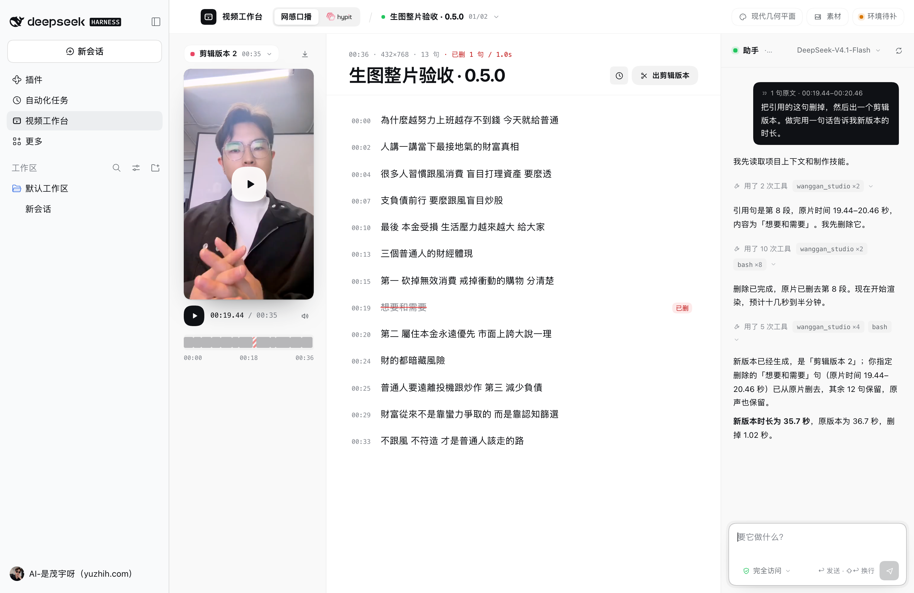
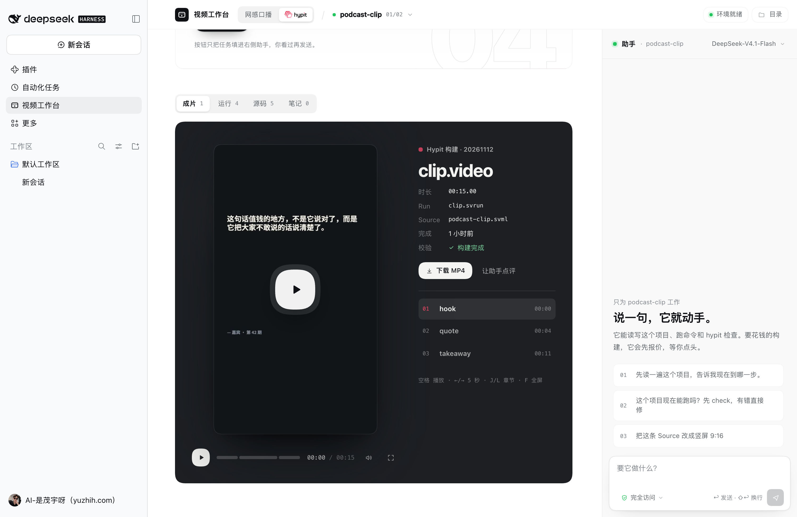
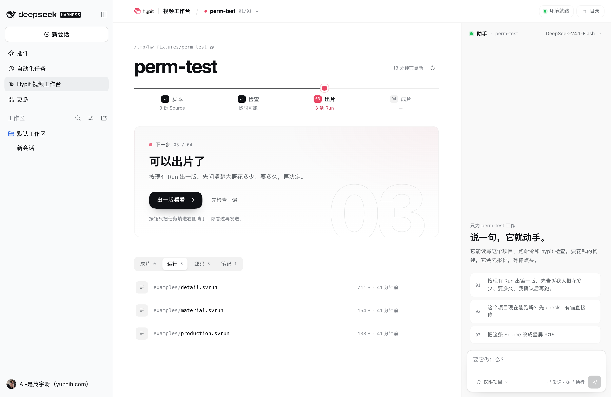
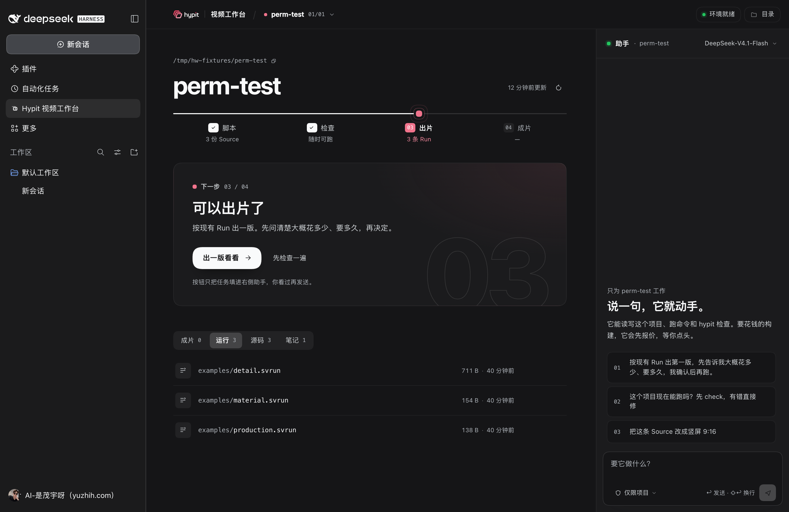
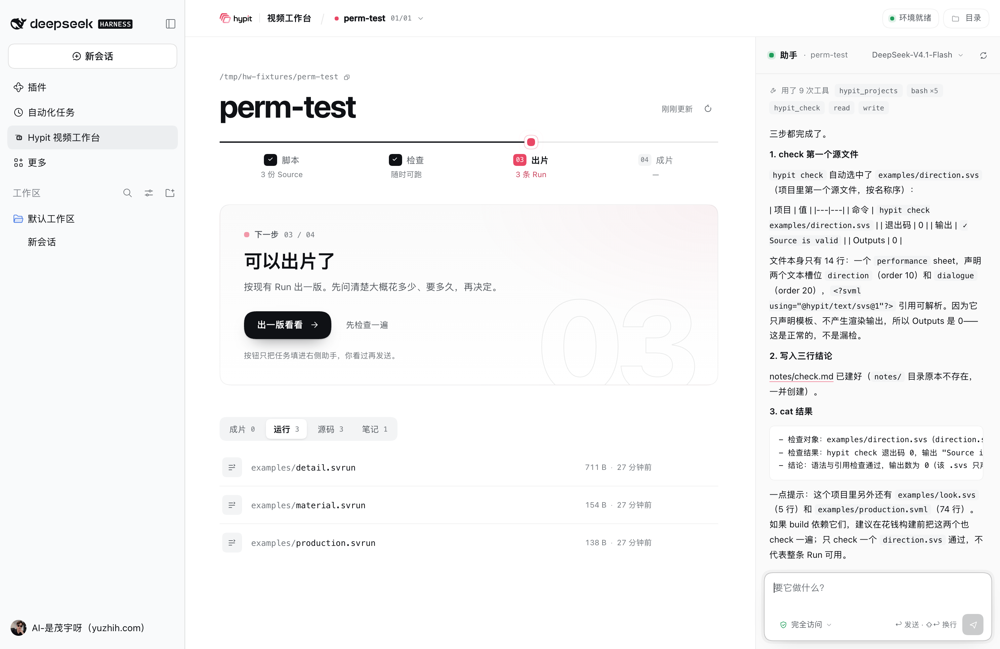
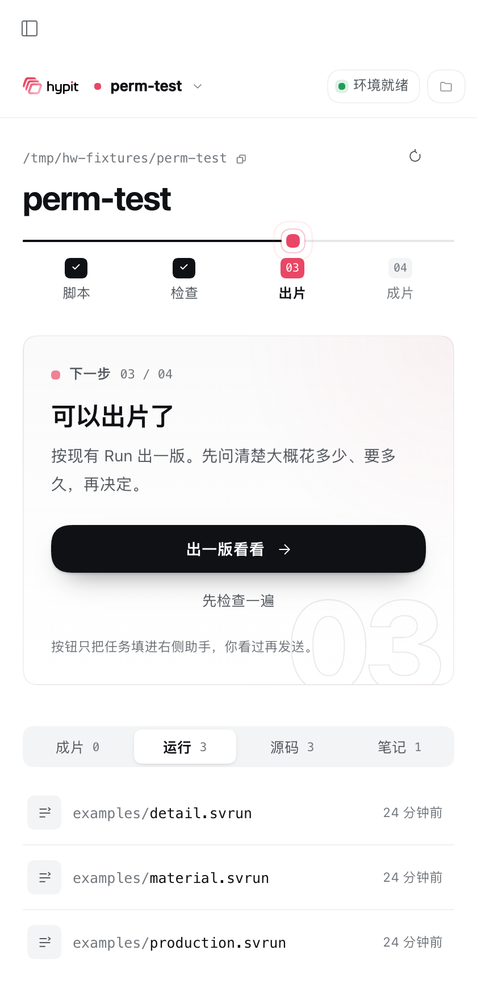

# 视频工作台 · dsh-hypit-workbench

DeepSeek Harness 插件：左侧栏「视频工作台」，一个入口，两个工作区——**网感口播**（文稿剪辑 + 整片制作）和 **Hypit**（SVML 视频项目）。两边都配一个只在面板里存在的助手：它不进会话列表，绑定当前这条口播或这个项目，能读写文件、跑命令，需要你拍板时在面板里弹选择卡片。




## 网感口播

原「网感口播」插件（dsh-wanggan-talking-head 0.5.1）已整体并入，旧插件可以移除。口播数据仍在 `~/.dsh/wanggan-talking-head`，打开即见。

| 区域 | 做什么 |
| --- | --- |
| 监看（左） | 原片 / 剪辑版本 / 创作版本切换，播放、静音、下载；下方语义条每句一格，删掉的句子显示为斜纹，红线是播放头 |
| 文稿（中） | 识别后的逐句文稿。点一句跳到那里；⇧ 连选、⌘ 多选；`⌫` 删、`⇧⌫` 恢复、`Q` 引用给助手、空格播放 |
| 助手（右） | 引用的原句以「已附 N 句原文」带进对话；它能删句、出剪辑版本、按画风做整片、设计并生成素材 |
| 成片 | 顶栏「剪辑 / 成片」切换。放映间：海报封面、按分镜分段的进度条（悬停看缩略图和章节名）、章节列表一键跳转、画风/编排/质检信息、下载 MP4、让助手点评；下方是这条口播的全部成片。键盘：空格、←/→、J/L 章节、F 全屏 |
| 顶栏 | 口播切换（`I` 导入）、母画风（19 套真实参考图 + 分支 + 编排）、素材与生图设置、本机环境检查 |

剪辑（删句 → 出剪辑版本）用 ffmpeg 在本机完成，原声不重编码以外的处理；识别用本地 faster-whisper；整片制作走随包的网感口播技能与 hyperframes 渲染；只有生图会调用你配置的服务，密钥只存在本机。

## 对话记录（0.15.0）

助手的对话按项目保存：每条口播、每个 Hypit 项目各有自己的对话列表。

- 重开工作台或重启应用后，自动接上这个项目最近的一段对话，记录从会话文件里读回，接着发就是在原对话里继续（模型记得上下文）。
- 助手标题就是对话切换器：点开看这个项目的全部对话（标题取第一句、时间、轮数，进行中的标红点），点一段就切过去；「＋ 新对话」开新的一段，旧的留在列表里。
- 「移出列表」只是不再显示，DSH 的会话文件不删。
- 0.15.0 之前留在磁盘上的面板对话会自动补进对应项目的列表（每个项目最多 20 段）。
- 换模型、换思考深度不再清空对话，原对话照常继续。

索引存在 `~/.dsh/hypit-workbench/chat-history.json`（权限 600，只含会话 ID、标题、时间、轮数），正文在 DSH 自己的会话文件里。

## 模型与密钥：一律跳到设置

工作台里不保存任何模型或密钥设置，所有入口都直接打开 DSH 设置：

| 入口 | 跳到 |
| --- | --- |
| 助手顶部模型 → 「添加或管理模型」、没配模型时的报错 | 设置 → 模型 |
| 网感口播「素材」里的生图模型、未连接时的「先连接生图模型」 | 设置 → 接口与密钥 → 生图 · Seedream |

助手里仍可以在已添加的模型间切换、选思考深度，这只影响这段对话。

## Hypit



「成片」标签直接读取 `hypit build` 的构建结果（`.hypit/results/<日期>/<构建>/result.json`）：播放成片，按时间窗分段的进度条与章节、Run / Source、构建状态、下载；项目里导出的视频（如 `out/*.mp4`）也会列出，和构建结果相同的文件自动去重。封面由 ffmpeg 从成片里取一帧。

**面板内对话**：对话、模型选择、思考深度都在工作台里；助手绑定当前项目的上下文，可以读源码、跑检查、给出片规划，或者直接改。主区只做三件事：告诉你现在到哪一步、下一步做什么、产出有哪些。



界面是「浅色 · 媒体架」的第二版：顶栏面包屑切项目，中间是制作台（标题 → 带播放头的四段进度 → 下一步 → 产出），右侧是助手。颜色全部取自宿主真实存在的 `--dsw-alias-*` token，Hypit 粉只用在播放头和录制点；宿主切深色（`body[data-ds-dark-theme]`）时自动跟随。版式用容器查询跟随面板宽度。

| 深色 | 对话中 | 窄面板 |
| --- | --- | --- |
|  |  |  |

### 新建项目

顶栏项目下拉最下面是「＋ 新建项目」（不在输入框里时按 `N` 也能打开）。填项目名和一句话描述，工作台会在扫描根目录下建好：

- `package.json`：带 `"hypit": { "project": true }` 标记（中文名写进 `hypit.title`，npm `name` 保持 ASCII）；
- `notes/brief.md`：你的描述（填了才建）。

建好后自动切到新项目，并把「按描述写第一版 SVML + .svrun，跑 check，不花钱」的任务填进助手，你看一眼再发送。同名项目不会被覆盖；项目名里的 `/`、`..` 等会被清理掉，不会写到根目录外面。

### 助手权限

面板里的助手没有审批弹窗，宿主默认的「工作区可写 + 逐条询问」会让越界操作直接失败。所以输入框左下角有一个权限开关，选择会记在本地：

| 选项 | 沙箱 | 审批 | 实测 |
| --- | --- | --- | --- |
| 完全访问（默认） | `danger-full-access` | `never` | 写 `notes/check.md`、跑 bash 均成功 |
| 仅限项目 | `workspace-write` | `never` | 写主目录被沙箱拒绝（`Operation not permitted`），不会卡住等确认 |

助手挂载宿主默认的 agent 预设，因此有完整的 read / write / edit / bash 工具，外加本插件的三个 `hypit_*` 工具。调用失败时（余额不足、未配置凭证等）面板会显示宿主返回的真实错误，并提供「重试」。

## 这个插件做什么

Hypit（[hypit-ai/hypit](https://github.com/hypit-ai/hypit)）是一个让 AI agent 克隆或从零制作视频的框架：项目边界由 `package.json` 里的 `"hypit": { "project": true }` 声明，作品写成 SVML，构建交给 `hypit` 可执行文件，判断和创意留给对话里的 agent 与技能。

本插件只补上「看」和「交接」两段，不替代 Hypit：

| 能力 | 说明 |
| --- | --- |
| 左侧栏入口 | `sidebar.panellist` 注册「Hypit 视频工作台」，点开是主面板 |
| 环境自检 | 顶栏「环境」里显示执行器、Hypit 技能、Node 与对话工具数，全部来自真实检查 |
| 自动建目录 | 第一次打开时，默认根目录（`~/Hypit`）不存在就在主目录内自动建好，只读扫描 |
| 项目扫描 | 按 `hypit.project` 标记发现项目，跳过 `node_modules`、`.git` 等；支持多根目录 |
| 制作进度 | 脚本 → 检查 → 出片 → 成片四段状态，按文件现状推导，不假装知道检查结果 |
| 下一步 | 根据项目状态给唯一主行动：写脚本 / 先检查 / 出一版 / 看成片 |
| 产出切换 | 成片、运行、笔记三类产出；「源码」抽屉带行号，超过 400 行注明截断 |
| 面板内对话 | 私有 agent，零会话；模型、思考深度、清空都在面板里，选择持久化在本地 |
| Agent 工具 | 注册 `hypit_projects` / `hypit_check` / `hypit_plan`，助手在对话里直接调用，返回真实命令、退出码与输出 |
| 微交互 | 复制路径反馈、行内「问助手」预填、弹出层、刷新旋转、发送/悬停/聚焦状态，`prefers-reduced-motion` 时全部降级 |

## 用起来还缺什么

插件能校验和规划，但「真的出一条视频」还要两件事，都不在插件里：

1. **执行器**：`npm install --global @hypit/hypit --registry=https://registry.npmjs.org`。用国内镜像会缺包（`@hypit/html-document` 404），所以要显式指定官方源。
2. **Runtime Profile 与模型账号**：`hypit doctor` 显示 `Runtime Profile not selected`；接上服务后 `hypit plan --runtime <profile>` 才会给出价格页，`hypit build` 才会真正生成。

还有一个已知坑：技能仓库 `main` 上的示例与 npm 发布版 `0.3.2` 有版本错位，直接跑 `hypit check` 会报 `Text Recipe does not accept stack-order` 和 `typo:Flow requires z`；按提示去掉/补上这两个属性后即可通过。

## 边界

- **不读凭证、不调用模型**：插件只做本地文件读取和对话草稿初始化。
- **不替你发送**：任务写进输入框，由你确认后发出。
- **不自动花钱**：生成的提示词里明确要求先给范围与花费、等确认后再提交生成。
- **面板本身只读**：扫描和展示不写项目；写入只来自你在助手里发出的指令，范围由上面的权限开关决定。
- **只能读扫描过的项目**：`project` / `source` 只接受最近一次扫描命中的项目路径，避免任意路径读取。

## 安装

离线安装包在插件根目录。桌面端：打开「插件」页 → 添加插件 → 选 `dsh-hypit-workbench-0.15.0.tgz`。

命令行（把 profile 换成你的）：

```bash
dsh plugin --profile desktop add ./dsh-hypit-workbench-0.15.0.tgz
```

安装后重启应用，左侧栏出现「Hypit 视频工作台」。详见 [INSTALL.md](INSTALL.md)。

> 本仓库只发布源码，不含构建好的 `.tgz`；需要安装包时在插件根目录执行 `npm install && npm pack` 自行生成。

## 配置

默认扫描 `~/Hypit`。改 `cordis.patch.yml` 里的 `roots`，或用面板顶部的「扫描根目录」临时输入（每行一个，支持 `~`，会记在本地浏览器里）。

```yaml
- insert:
    - id: hypit-workbench
      name: dsh-hypit-workbench
      config:
        roots:
          - "~/Hypit"
          - "~/Movies/hypit-projects"
```

找不到项目时，面板会给出四步准备清单：装技能、准备执行器、指定项目根、扫描。

## 面板读什么

一个目录要成为项目，需要：

```json
{
  "name": "goat-debate",
  "hypit": { "project": true }
}
```

面板按扩展名分类：`.svml` / `.svs` 是 Source，`.svrun` 是 Run，`.md` 是笔记，常见音视频是结果文件。这是 Hypit 的工作约定，不是它强制的语法——所以面板只做展示，不据此判断成败。

## 数据与权限

- 只有应用所有者（`principal.kind === 'owner'`）能调用本插件的服务。
- 扫描根目录会被校验：必须是存在的绝对目录，拒绝 `/`、整个主目录和 `~/.dsh`。
- 缺失的根目录只在**主目录内**自动创建（`mkdir -p`）；主目录以外（外置盘、系统目录）不会替你建，会明确报错。
- 单次扫描最多 12 个根目录、每个根最多 120 个项目、每个项目最多 400 个文件；命中上限会在界面上说明「只显示了一部分」。
- 执行器探测会在 PATH 和项目 `node_modules/.bin` 里找 `hypit`，只跑 `hypit --version`，4 秒超时。

## 开发

```bash
npm install
npm test          # 57 项单元测试（含网感口播存储、渲染、画风、生图）（项目发现、路径校验、源码读取、提示词、agent 工具、权限固定）
npm run build     # esbuild 打 dist/client.js，按宿主 __ModuleLoader__ 协议包裹
npm run check     # 语法检查 + 产物检查
npm pack          # 生成 tgz（prepack 会先构建）
```

结构：

| 文件 | 作用 |
| --- | --- |
| `src/host.js` | Host 服务 `hypitWorkbench`，`overview` / `project` / `source` / `create` / `chat` / `check` / `plan`，并注册 agent 工具 |
| `src/tools.js` | 三个 agent 工具的 schema 与注册（按 `agent/created` 注册到会话） |
| `src/tool-logic.js` | 工具的实际逻辑（项目校验、扫描、check、plan），可单测 |
| `src/store.js` | 项目发现、源码读取、执行器与技能探测（纯文件操作，可单测） |
| `src/prompt.js` | 三种交接的提示词构造（纯函数） |
| `src/client.jsx` | 左侧栏入口与主面板（媒体架布局） |
| `src/session-access.js` | 面板助手的权限固定与事件摘要（可单测） |
| `src/chat-history.js` | 每个项目的对话索引（标题、时间、轮数） |
| `src/client/keys.js` | 跳转「设置 → 模型」「设置 → 接口与密钥」 |
| `src/styles.css` | `--dsw-alias-*` → `--hw-*` 映射层 + 面板样式 |
| `src/assets/` | Hypit 官方 logo（见 [NOTICE.md](NOTICE.md)） |
| `src/typert.js` | Remote 描述符 |
| `cordis.patch.yml` | 默认配置层 |

## 已验证

在 `0.2.2-rc.1` 宿主上，用隔离 `DSH_HOME` 的 profile 安装本 tgz 后实测：

- 配置合成出 `id: hypit-workbench` 且 `roots` 生效；
- 首次打开时 `~/Hypit` 不存在会自动创建，面板提示「已创建」，再次打开不会重复创建；
- 左侧栏出现「Hypit 视频工作台」，点击进入主面板；
- 输入根目录扫描到 2 个 Hypit 项目；选中后四统计（Sources / Runs / Notes / Results）与源码分页正常；
- 顶栏「工具」显示 3，悬停列出 `hypit_projects, hypit_check, hypit_plan`；
- 三个工具的逻辑有单测：项目标记校验、扫描输出、缺源/缺 Run 时返回可读错误而不是抛异常；
- 点起手句填进输入框、再点「在对话里开始」，直接新建并切到一条对话，标题为 `Hypit · <项目>`；
- 该对话输入框里是任务草稿，实测包含：项目目录、当前统计（3 Source / 3 Run）、三个工具名、以及「确认后再提交」的费用边界；
- 浏览器控制台无报错；浅色为验收主题，深色下 token 生效、文字可读。

另外把已有桌面 profile（含其他几个本地安装的插件）硬链接复制成独立 profile，加上本插件后启动：Work 模式正常进入，侧栏同时保留原有入口，本插件入口打开面板无报错。

未覆盖：`hypit build` 的真实构建链路与成片预览，需要先接 Runtime Profile 与模型账号。

## 许可

本插件自有代码为 MIT，见 [LICENSE](LICENSE)。

随包的 `vendor/wanggan` 是作者维护的「网感口播」组件包：目录内自带 [vendor/wanggan/LICENSE](vendor/wanggan/LICENSE)（MIT，Copyright (c) 2026 Maoyu / GitHub maomyu，上游仓库 `maomyu/wanggan-talking-head`），本仓库按该文件一并分发。若要把它用于本插件以外的用途，请以该 LICENSE 和上游仓库的授权为准。

`vendor/wanggan` 里的字体、参考图片、示例视频等素材分别来自各自上游；本仓库不对这些第三方素材单独作开源许可声明，再分发前请核实原始授权。

Hypit 官方 logo 的许可见 [NOTICE.md](NOTICE.md)。Hypit 本身是 Apache-2.0（附条件），本插件不包含其代码，只读取它的项目文件约定。
